# 🚀 CI/CD Pipeline with GitHub Actions, Docker & Kubernetes

<p align="center">
  
  
  
  
  
</p>

## 📌 Project Overview

This project demonstrates the implementation of an end-to-end **Continuous Integration and Continuous Deployment (CI/CD) pipeline** using GitHub Actions, Docker, Docker Hub, and Kubernetes with Minikube.

A Python Flask application is automatically tested, containerized, published to Docker Hub, and deployed to a local Kubernetes cluster whenever code is pushed to the `main` branch.

The project demonstrates practical DevOps automation without requiring a cloud-hosted Kubernetes environment.

### 🎯 Project Objectives

- Implement Continuous Integration using GitHub Actions.
- Automate Python application testing with Pytest.
- Build Docker images automatically.
- Push Docker images to Docker Hub.
- Configure a GitHub self-hosted runner.
- Automate application deployment to Minikube.
- Manage application replicas using Kubernetes Deployments.
- Expose the application using a Kubernetes NodePort Service.
- Verify application availability and deployment status.

---

## 🏗️ System Architecture

The following diagram illustrates the complete CI/CD workflow.

```text
                  👨‍💻 Developer
                       |
                       | Git Push
                       v
                GitHub Repository
                       |
                       v
               GitHub Actions
                       |
                       v
              +------------------+
              |   Python Tests   |
              |      Pytest      |
              +------------------+
                       |
                 Tests Passed
                       |
                       v
              +------------------+
              |  Docker Build    |
              |  Docker Buildx   |
              +------------------+
                       |
                       v
                  Docker Hub
                       |
                       v
              Self-Hosted Runner
                       |
                       v
                   Minikube
                       |
                       v
             Kubernetes Deployment
                       |
                       v
                Application Pods
                       |
                       v
              Kubernetes Service
                       |
                       v
                Flask Application
```

### 🔄 CI/CD Workflow

1. Developer pushes code to GitHub.
2. GitHub Actions triggers the workflow.
3. Python dependencies are installed.
4. Pytest executes automated application tests.
5. Docker image is built after successful tests.
6. Docker image is pushed to Docker Hub.
7. Self-hosted runner executes the deployment job.
8. Kubernetes Deployment updates the application image.
9. Kubernetes verifies the deployment rollout.
10. Application endpoints are tested.

---

## 🛠️ Technology Stack

| Technology | Purpose |
|---|---|
| Python 3.12 | Application development |
| Flask 3.1.1 | Web application framework |
| Pytest 8.3.5 | Automated testing |
| Git | Version control |
| GitHub | Source code hosting |
| GitHub Actions | CI/CD automation |
| Docker | Containerization |
| Docker Hub | Container image registry |
| Docker Compose | Local container management |
| Kubernetes | Container orchestration |
| Minikube | Local Kubernetes cluster |
| kubectl | Kubernetes management |
| WSL Ubuntu | Linux development environment |

---

## 📁 Project Structure

```text
github-actions-docker-cicd/
│
├── .github/
│   └── workflows/
│       └── ci.yml
│
├── app/
│   ├── __init__.py
│   └── main.py
│
├── tests/
│   └── test_app.py
│
├── k8s/
│   ├── deployment.yaml
│   └── service.yaml
│
├── screenshots/
│   ├── 01-github-repository.PNG
│   ├── 02-github-actions-success.PNG
│   ├── 03-python-tests.PNG
│   ├── 04-github-actions-docker-build-push.PNG
│   ├── 05-github-actions-docker-build-push.PNG
│   ├── 06-github-actions-docker-build-push.PNG
│   ├── 06-kubernetes-pods.PNG
│   ├── 07-github-actions-docker-build-push.PNG
│   ├── 08-docker-hub-image.PNG
│   ├── 09-kubernetes-service.PNG
│   └── 10-kubernetes-application-endpoints.PNG
│
├── .dockerignore
├── .gitignore
├── Dockerfile
├── docker-compose.yml
├── requirements.txt
└── README.md
```

---

## 🐍 Application Details

The project uses a Python Flask application that provides three REST API endpoints.

### Application Endpoints

| Endpoint | HTTP Method | Description |
|---|---|---|
| `/` | GET | Returns application information |
| `/health` | GET | Checks application health |
| `/version` | GET | Returns application version |

### API Response Examples

**1. Home Endpoint**

`GET /`

```json
{
  "application": "CI/CD Demo Application",
  "message": "Welcome! Application is running successfully.",
  "status": "Running"
}
```

**2. Health Endpoint**

`GET /health`

```json
{
  "status": "healthy"
}
```

**3. Version Endpoint**

`GET /version`

```json
{
  "version": "1.0",
  "deployment": "Local"
}
```

---

## ⚙️ GitHub Actions CI/CD Pipeline

The automated workflow is configured in:

`.github/workflows/ci.yml`

The pipeline contains three jobs.

### 1️⃣ Job: Run Python Tests

**Purpose:** Continuous Integration.

Steps:

- Checkout the source code.
- Set up Python 3.12.
- Install project dependencies.
- Execute tests using Pytest.
- Verify application functionality.

Command:

```bash
python -m pytest -v
```

### 2️⃣ Job: Build and Push Docker Image

**Purpose:** Build and publish the application container.

Steps:

- Configure Docker Buildx.
- Authenticate with Docker Hub.
- Build the Docker image.
- Push the image to Docker Hub.

The workflow publishes two tags:

- `latest`
- Git commit SHA

Docker image:

```text
ruchiamey3117/cicd-app:latest
```

### 3️⃣ Job: Deploy to Local Minikube

**Purpose:** Continuous Deployment.

This job executes on the configured self-hosted GitHub Actions runner.

Steps:

- Verify Kubernetes connectivity.
- Check the current Kubernetes context.
- Update the application Deployment with the new Docker image.
- Verify rollout status.
- Check Deployments, Pods, and Services.

Deployment command:

```bash
kubectl set image deployment/cicd-app \
  cicd-app=ruchiamey3117/cicd-app:latest
```

The actual automated workflow uses the image tagged with the current Git commit SHA.

---

## 🔐 GitHub Repository Secrets

The following secrets are configured in GitHub repository settings.

| Secret | Description |
|---|---|
| `DOCKER_USERNAME` | Docker Hub username |
| `DOCKER_TOKEN` | Docker Hub access token |

Secrets are securely stored in GitHub and referenced through workflow expressions.

No credentials are hardcoded in the application source code.

---

## 🐳 Docker Configuration

The Flask application is containerized using Docker.

### Dockerfile

```dockerfile
FROM python:3.12-slim

WORKDIR /app

COPY requirements.txt .

RUN pip install --no-cache-dir -r requirements.txt \
    && pip install --no-cache-dir gunicorn

COPY app/ ./app/

EXPOSE 5000

CMD ["gunicorn", "--bind", "0.0.0.0:5000", "app.main:app"]
```

### Build Docker Image

```bash
docker build -t cicd-app .
```

### Run Docker Container

```bash
docker run -d -p 5000:5000 --name cicd-app-local cicd-app
```

### Verify Docker Container

```bash
docker ps
```

### Docker Hub Repository

**Image Name:**

`ruchiamey3117/cicd-app`

🔗 [View Docker Hub Repository](https://hub.docker.com/r/ruchiamey3117/cicd-app)

---

## ☸️ Kubernetes Deployment with Minikube

The application is deployed to a local Kubernetes cluster using Minikube.

### Deployment Configuration

| Configuration | Value |
|---|---|
| Deployment Name | `cicd-app` |
| Replicas | 2 |
| Container Port | 5000 |
| Service Name | `cicd-app-service` |
| Service Type | NodePort |
| NodePort | 30007 |
| Namespace | default |

### Start Minikube

```bash
minikube start --driver=docker
```

### Apply Kubernetes Manifests

```bash
kubectl apply -f k8s/deployment.yaml
kubectl apply -f k8s/service.yaml
```

### Verify Deployment

```bash
kubectl get deployments
```

### Verify Pods

```bash
kubectl get pods
```

### Verify Services

```bash
kubectl get services
```

### Access the Application

Use Kubernetes port forwarding:

```bash
kubectl port-forward service/cicd-app-service 5002:5000
```

Keep the port-forward process running in one terminal.

Open another terminal and test the endpoints:

```bash
curl http://127.0.0.1:5002/
curl http://127.0.0.1:5002/health
curl http://127.0.0.1:5002/version
```

---

## 🚀 Local Setup and Execution

### Prerequisites

Install the following tools:

- Git
- Python 3.12
- Docker Desktop
- Docker Compose
- kubectl
- Minikube

### Step 1: Clone Repository

```bash
git clone https://github.com/ruchi1792/github-actions-docker-cicd-Elevate--labs.git
```

### Step 2: Navigate to Project

```bash
cd github-actions-docker-cicd-Elevate--labs
```

### Step 3: Install Dependencies

```bash
python3 -m pip install -r requirements.txt
```

### Step 4: Run Automated Tests

```bash
python3 -m pytest -v
```

### Step 5: Build Docker Image

```bash
docker build -t cicd-app .
```

### Step 6: Start Minikube

```bash
minikube start --driver=docker
```

### Step 7: Deploy to Kubernetes

```bash
kubectl apply -f k8s/
```

### Step 8: Verify Kubernetes Resources

```bash
kubectl get deployments
kubectl get pods
kubectl get services
```

---

## 🧪 Project Verification Results

The following results were verified during project implementation.

| Component | Result |
|---|---|
| Flask Application | Running |
| Python Unit Tests | 3 tests passed |
| GitHub Actions CI | Successful |
| Docker Image Build | Successful |
| Docker Hub Push | Successful |
| Self-Hosted Runner | Connected |
| Minikube Cluster | Running |
| Kubernetes Deployment | 2/2 replicas ready |
| Kubernetes Pods | 2 running |
| Kubernetes Service | NodePort configured |
| Flask API Endpoints | Successfully responding |

---

# 📸 Project Screenshots

The following screenshots provide visual evidence of the project implementation, CI/CD execution, Docker image publishing, and Kubernetes deployment.

### 1. GitHub Repository Overview

Displays the GitHub repository and project source code structure.

[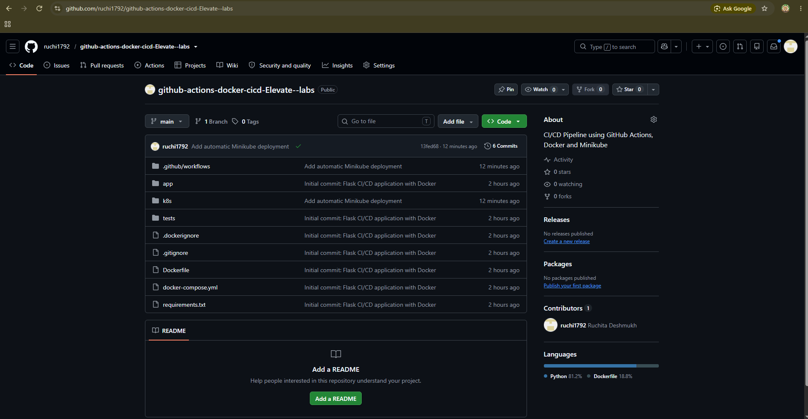](screenshots/01-github-repository.PNG)

### 2. GitHub Actions – Successful CI/CD Pipeline

Demonstrates the successful execution of the GitHub Actions workflow.

[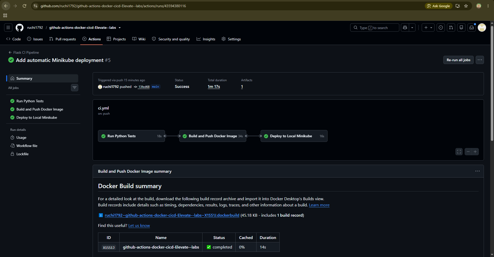](screenshots/02-github-actions-success.PNG)

### 3. Python Automated Test Results

Shows the successful execution of application tests using Pytest.

[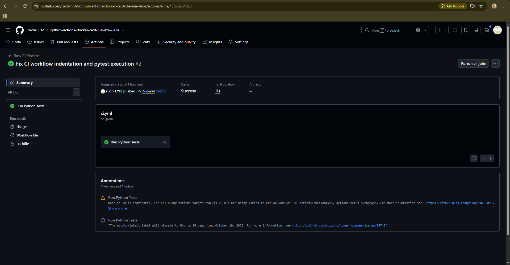](screenshots/03-python-tests.PNG)

### 4. Docker Build and Push – Execution 1

Shows the Docker image build and publishing process.

[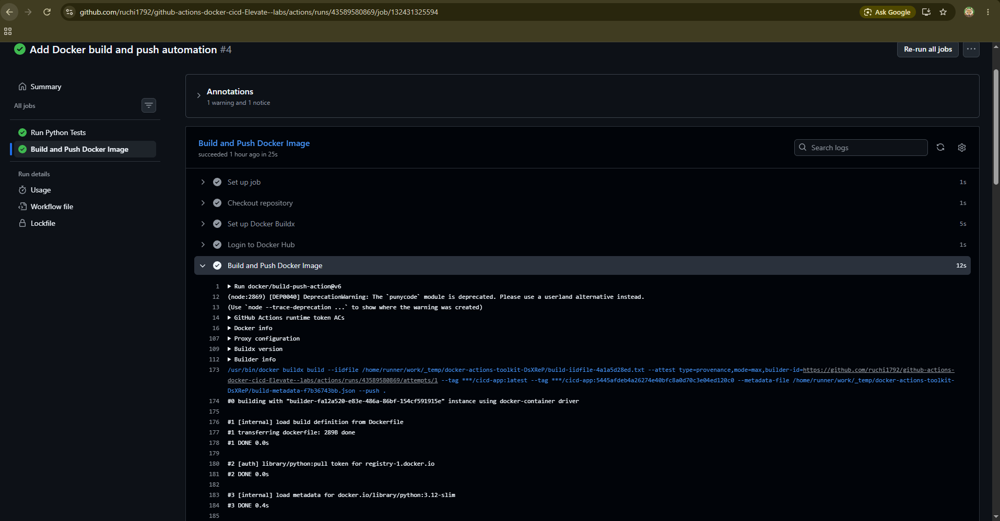](screenshots/04-github-actions-docker-build-push.PNG)

### 5. Docker Build and Push – Execution 2

Additional evidence of the GitHub Actions Docker build and push job.

[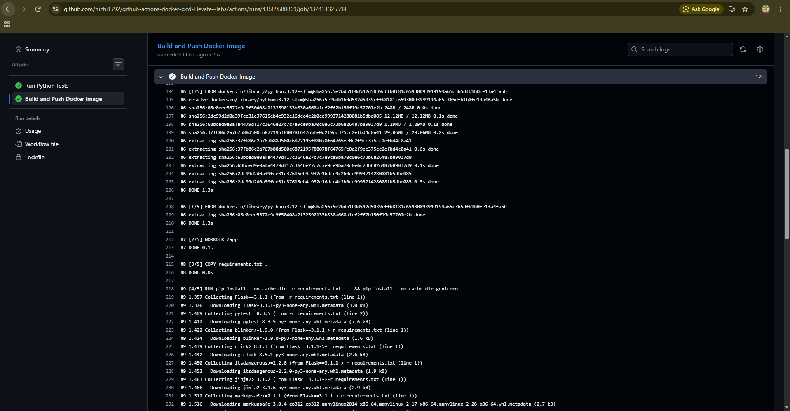](screenshots/05-github-actions-docker-build-push.PNG)

### 6. Docker Build and Push – Execution 3

Additional workflow execution evidence.

[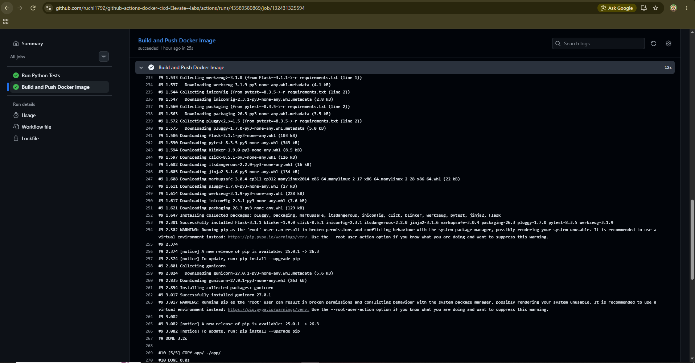](screenshots/06-github-actions-docker-build-push.PNG)

### 7. Kubernetes Deployment and Running Pods

Shows the application Pods running inside the Minikube Kubernetes cluster.

[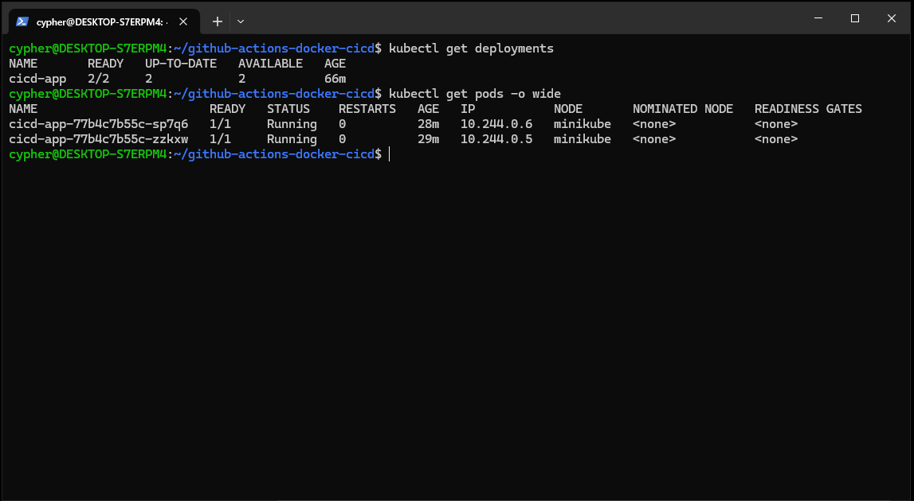](screenshots/06-kubernetes-pods.PNG)

### 8. Docker Build and Push – Execution 4

Additional evidence of the Docker image publishing workflow.

[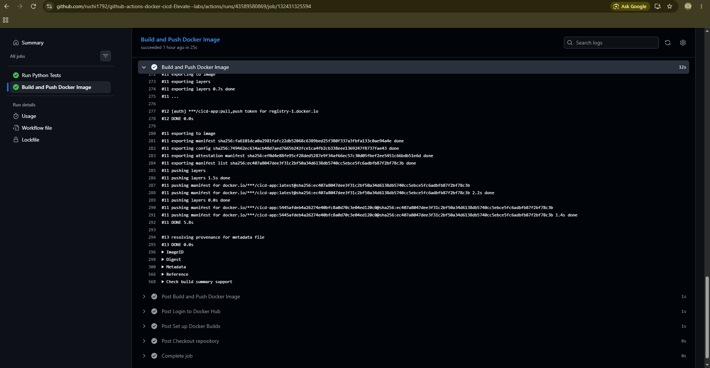](screenshots/07-github-actions-docker-build-push.PNG)

### 9. Docker Hub Repository

Displays the published Docker image and image tags.

[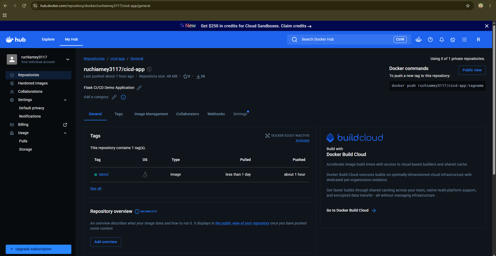](screenshots/08-docker-hub-image.PNG)

### 10. Kubernetes NodePort Service

Shows the Kubernetes Service configuration used to expose the Flask application.

[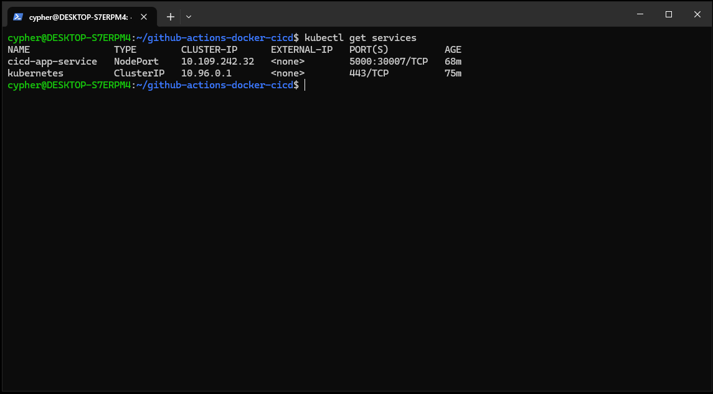](screenshots/09-kubernetes-service.PNG)

### 11. Flask Application – API Responses

Demonstrates the successful responses from the deployed Flask application endpoints.

[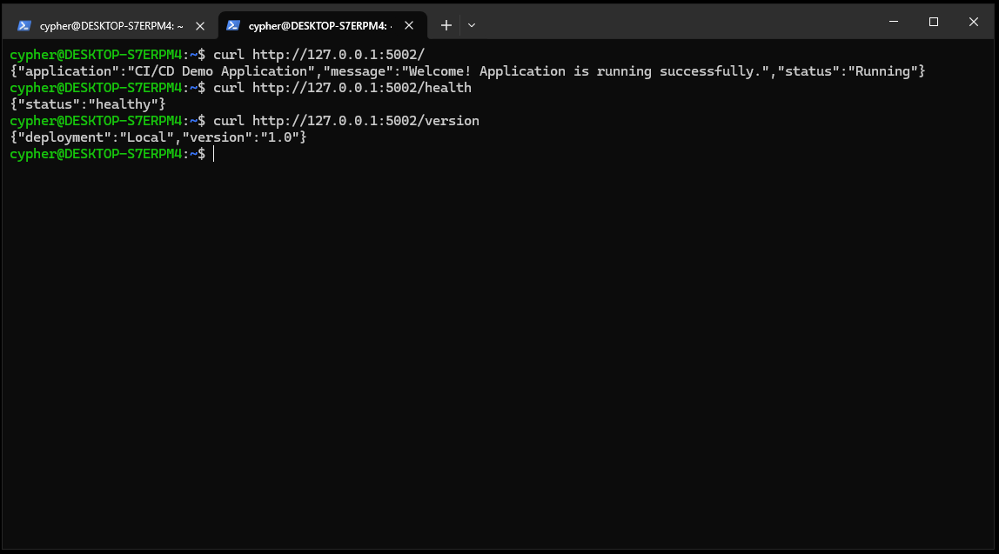](screenshots/10-kubernetes-application-endpoints.PNG)

---

## 🔗 Project Links

| Resource | Link |
|---|---|
| GitHub Repository | [View Source Code](https://github.com/ruchi1792/github-actions-docker-cicd-Elevate--labs) |
| Docker Hub | [View Docker Image](https://hub.docker.com/r/ruchiamey3117/cicd-app) |

---

## 📚 Key Learnings

Through this project, I gained practical experience in:

- Designing end-to-end CI/CD pipelines.
- Implementing automated workflows using GitHub Actions.
- Running Python unit tests using Pytest.
- Building and managing Docker images.
- Publishing container images to Docker Hub.
- Configuring GitHub self-hosted runners.
- Deploying containerized applications to Kubernetes.
- Managing Deployments, Pods, and Services.
- Automating Minikube deployments.
- Troubleshooting Docker, Kubernetes, and CI/CD workflows.

---

## 🎓 Conclusion

This project successfully demonstrates an end-to-end CI/CD pipeline using GitHub Actions, Docker, Docker Hub, and Kubernetes with Minikube.

The pipeline automates application testing, Docker image creation, image publishing, and Kubernetes deployment.

It provides hands-on experience with essential DevOps practices, containerization, automation, and orchestration without requiring a cloud-hosted Kubernetes environment.

**🚀 Project Status: Successfully Implemented and Verified.**

---

<p align="center">
  <b>⭐ Thank you for visiting this project! ⭐</b>
  <br>
  <i>Built with Python, Docker, GitHub Actions & Kubernetes.</i>
</p>
